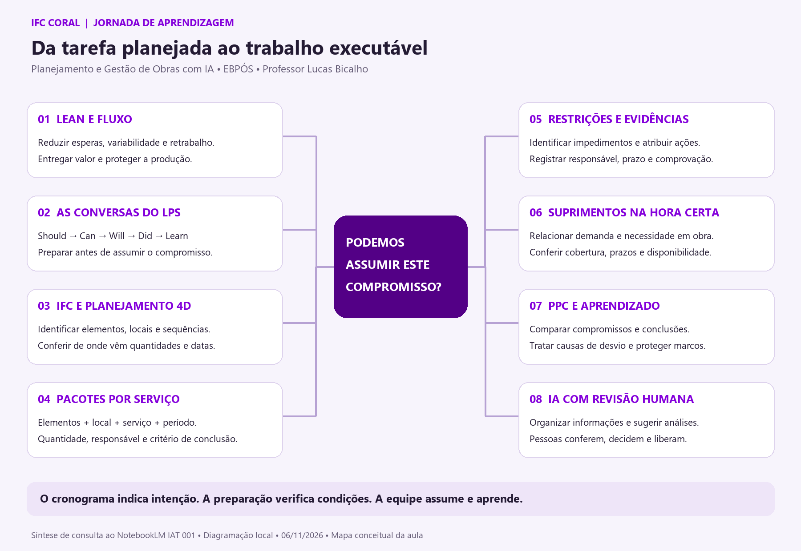

<p align="center"></p>

# IFC Coral

**A tarefa está no cronograma. Mas ela pode começar na obra?**

Na disciplina **Planejamento e Gestão de Obras com IA — EBPÓS**, essa pergunta conecta Lean Construction, Last Planner System, BIM 4D e inteligência artificial. O IFC Coral é nosso laboratório didático para percorrer essa decisão: localizar os elementos, conferir quantidades e datas, preparar pacotes, tratar restrições e examinar as necessidades de suprimentos.

**Professor Lucas Bicalho** · [Materiais da turma](https://drive.google.com/drive/folders/1I36l-GWqufSSFH3ZuI0tSnSONYQTTYXc) · [Código atualizado](https://github.com/bicalhobim/ifc-coral/tree/feat/ifc-coral-mvp) · [Instalação](#instalação-com-codex)

> **Escolha a versão correta.** Em 06/11/2026, o código atualizado está na branch **`feat/ifc-coral-mvp`**, commit **`228ef62`**. A branch padrão `main` ainda contém a base anterior do aplicativo, com esta página de apresentação atualizada. Para instalar os recursos descritos abaixo, use a branch indicada. Não baixe o ZIP da `main` esperando a mesma versão.

## O raciocínio da aula

Uma concretagem pode estar prevista no Gantt e ainda depender de projeto, fôrmas, armaduras, equipe, acesso, equipamento e entrega de concreto. O modelo e o cronograma ajudam a examinar a sequência; a preparação verifica se há condições para assumir o compromisso.



*Mapa elaborado a partir de consulta ao NotebookLM da IAT 001 em 06/11/2026, com síntese editorial e diagramação local. Representa a trilha de aprendizagem; não é uma certificação de capacidades do software. [Versão vetorial](docs/media/mapa-jornada-iat001.svg).*

| Conversa do LPS | Pergunta que orienta o trabalho |
|---|---|
| **Should — deveria** | Quais marcos e atividades orientam a sequência da obra? |
| **Can — pode** | Quais restrições precisamos remover no lookahead? |
| **Will — será feito** | O que a equipe pode assumir com critério, responsável e prazo? |
| **Did — foi feito** | O que foi concluído conforme o compromisso registrado? |
| **Learn — aprender** | Quais causas de desvio precisam mudar o próximo plano? |

O elemento IFC mantém a referência física. Um pacote reúne **elementos + local + serviço + quantidade + período + responsável + condições de execução**. O mesmo elemento pode participar de serviços distintos, como fôrmas, armação e concretagem.

## Comece pelo seu objetivo

| Na home da versão atualizada | Como usar |
|---|---|
| **Explore — Projeto Modelo** | Conheça um cenário preenchido com dados fictícios e um tour que pode ser reiniciado. |
| **Pratique — Exercício 02** | Abra uma cópia independente da TORRE02 com IFC/4D e construa os próprios pacotes. |
| **Crie — Meu Novo Projeto** | Comece com projeto vazio e modelo próprio, escolhendo sua pasta de trabalho. |

Explore e Pratique usam cópias independentes. Salve a sua em uma pasta de projeto. O endereço local funciona apenas no computador em que o servidor está em execução.

## O percurso dentro do Coral

| Etapa | Ação | Conferência |
|---|---|---|
| **1. Modelo e cronograma** | Importe o IFC ou abra a TORRE02; explore a árvore, o Gantt e a linha de balanço. | Modelo, elementos, local e origem das datas. |
| **2. Preparação 4D, se necessária** | Analise os modelos, confira o CSV e associe atividades por código/propriedade IFC. | Escopo dos modelos, códigos, datas, linhas pendentes e vínculos. |
| **3. Quantidades e serviços** | Confira concreto, aço e fôrmas conforme os dados e métodos disponíveis. | Unidade, origem, taxa adotada e cobertura da medição. Ausência não é zero. |
| **4. Pacotes** | Crie pacotes por serviço e acompanhe a lista ou Kanban. | Quantidades, elementos e datas próprias de cada serviço, com ajustes humanos preservados. |
| **5. Restrições** | Use o checklist e o painel com filtros por local, responsável e situação. | Condição, ação, prazo e evidência antes da liberação. |
| **6. Suprimentos** | Examine e ajuste a demanda em tabela; confira necessidade em obra e preparação da compra. | Composição, quantidade, cobertura, saldo, prazos e premissas. |
| **7. Compromisso e aprendizado** | Registre compromissos semanais, execução, evidências e PPC. | Critério congelado, resultado e causa de não conclusão. |

**No Exercício 02, o recorte termina no download do JSON para a análise seguinte.** A continuidade didática com comparação de propostas, compromisso e PPC segue a orientação do professor. O mapa de suprimentos não envia pedidos nem compra materiais.

## O que mudou na versão publicada de desenvolvimento

- **Preparação IFC + CSV em etapas:** modelos, dados e correções, cronograma, associações, revisão e aplicação em cópias conferidas.
- **Associação por códigos verificáveis:** coluna do CSV e propriedade IFC configuradas por modelo, com revisão dos vínculos. A associação básica dispensa IA.
- **Cronogramas maiores:** normalização de até 1.000 atividades e datas exportadas como `Ter 01/10/24`, além dos formatos convencionais. Linhas sem informação ou sem vínculo continuam visíveis.
- **Datas por serviço nos pacotes:** o período disponível no cronograma aparece na conferência. Pode ser ajustado; ambiguidades e ausências pedem decisão.
- **Gestão integrada:** painel de restrições, pacotes em Kanban, catálogos editáveis, mapa de suprimentos em tabela, Gantt/linha de balanço e organização das janelas.
- **Projeto local:** salvar, salvar como, histórico e salvamento automático após escolher a pasta, com indicação de falhas.

Esses recursos estão registrados na branch indicada; não significam compatibilidade universal com qualquer IFC. A aplicação de cronograma preserva os originais e possui bloqueios para revisões com cronogramas existentes ou pacotes vinculados. Consulte o [guia de importação](https://github.com/bicalhobim/ifc-coral/blob/feat/ifc-coral-mvp/docs/IMPORTACAO_CRONOGRAMA.md).

## Instalação com Codex

Prepare o **ChatGPT para Windows e o Codex** conforme o guia técnico da atividade prévia, acesso à internet e permissões de administrador quando a instalação exigir. A oficina síncrona em grupo é não avaliativa; a preparação técnica é necessária para operar junto com o professor.

Abra o Codex e use esta solicitação:

```text
Quero instalar o IFC Coral no Windows para acompanhar a aula.
Use https://github.com/bicalhobim/ifc-coral, branch feat/ifc-coral-mvp.
Antes de instalar, confira o commit publicado e informe qual será executado.
Prepare uma cópia independente, leia AGENTS.md e README.md e confira Node.js 24.
Instale as dependências pelo lockfile. Se eu for usar Preparação IFC + CSV,
confira também Python e IfcOpenShell conforme docs/IMPORTACAO_CRONOGRAMA.md.
Inicie o servidor em 127.0.0.1:5178, abra no navegador e confira a home
e o carregamento do exemplo. Explique como parar e iniciar novamente.
Não altere outros projetos, não faça commit e não publique meus arquivos.
```

<details>
<summary><strong>Comandos para uma instalação independente</strong></summary>

```powershell
git clone --branch feat/ifc-coral-mvp --single-branch https://github.com/bicalhobim/ifc-coral.git
cd ifc-coral
git log -1 --oneline
cd viewer
npm ci
npm run dev -- --host 127.0.0.1 --port 5178 --strictPort
```

Abra [o Coral neste computador](http://127.0.0.1:5178/). Mantenha o terminal aberto; encerre com `Ctrl+C`.
A Preparação IFC + CSV também requer o ambiente Python/IfcOpenShell descrito no guia de importação.

**Atenção à cópia de desenvolvimento:** em `C:\dev\ifc4all-2`, as dependências são compartilhadas. Não execute `npm ci` nessa pasta; use uma cópia independente.

</details>

A entrada local não autentica contas nem registra presença. Instalação em outro computador e seletor nativo de pastas ainda precisam de ensaio completo; os testes locais não substituem essa verificação.

## Telas e materiais

As capturas abaixo são históricas de ensaios locais com dados de demonstração. A posição dos comandos pode variar com a versão.


Use os [materiais da turma no Drive](https://drive.google.com/drive/folders/1I36l-GWqufSSFH3ZuI0tSnSONYQTTYXc) conforme a liberação pelo professor. O acesso depende das permissões da pasta. Slides e atividades são disponibilizados na sequência da aula; gabaritos e notas docentes têm distribuição própria.

[Projetos locais](https://github.com/bicalhobim/ifc-coral/blob/feat/ifc-coral-mvp/docs/PROJETOS_LOCAIS.md) · [Quantificação](https://github.com/bicalhobim/ifc-coral/blob/feat/ifc-coral-mvp/docs/QUANTIFICACAO.md) · [Planejamento e janelas](https://github.com/bicalhobim/ifc-coral/blob/feat/ifc-coral-mvp/docs/GUIA_PLANEJAMENTO_JANELAS.md) · [Gestão de restrições](https://github.com/bicalhobim/ifc-coral/blob/feat/ifc-coral-mvp/docs/GESTAO_RESTRICOES.md)

## IA, evidência e decisão humana

A IA auxilia a organizar informações e sugerir condições para revisão. Cálculos e vínculos por código seguem regras verificáveis. Uma data herdada do cronograma representa previsão; não libera restrições nem registra compromisso automaticamente.

Use dados fictícios nos exercícios. Confira a autorização antes de enviar informações reais a provedores de IA. Credenciais não devem ser colocadas em arquivos ou mensagens.

O Coral é um **protótipo didático local**. Estimativas de aço e fôrmas dependem das premissas e não substituem projeto ou medição. A exportação para Compras IA organiza dados para a análise seguinte; não autoriza compras.

## Origem e créditos

Projeto e condução didática: **Professor Lucas Bicalho**. O IFC Coral parte do [IFC4ALL](https://github.com/bicalhobim/ifc4all) e da evolução 4D, com contribuição de Luiz Sales. A autorização específica de uso do código 4D e da TORRE02 não estabelece licença aberta para todo o projeto.

[Créditos e bibliotecas](docs/CREDITOS.md) · [Avisos de terceiros](third_party/README.md)

A licença geral e a distribuição de modelos e materiais continuam sujeitas à revisão própria.

**[GitHub](https://github.com/bicalhobim) · [LinkedIn](https://www.linkedin.com/in/bicalhobim/) · [lucas@bicalhoengenharia.com](mailto:lucas@bicalhoengenharia.com)**
