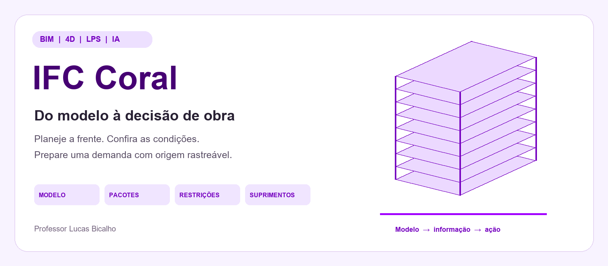
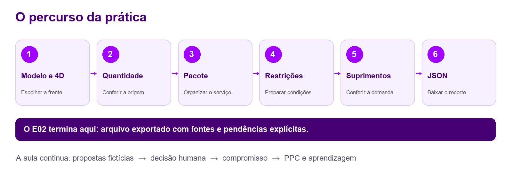
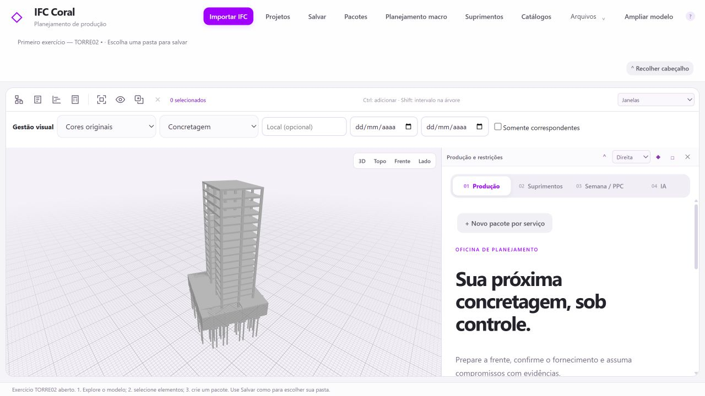
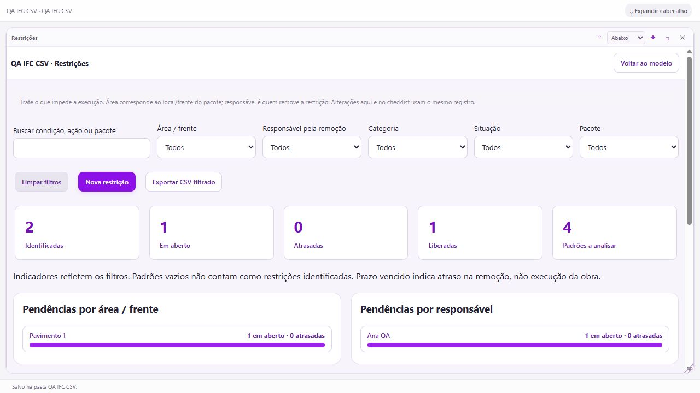
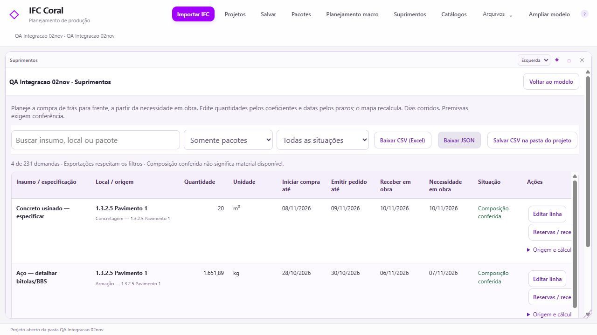

<p align="center">
  
</p>

# IFC Coral

Explore um modelo de obra, confira a origem das quantidades, organize pacotes e restrições e prepare uma demanda rastreável para suprimentos. O IFC Coral é um laboratório didático local de **BIM, planejamento 4D e Last Planner System**, com decisões conferidas por pessoas.

**[Abrir o GitHub do projeto](https://github.com/bicalhobim/ifc-coral)** · **[Materiais da turma no Google Drive](https://drive.google.com/drive/folders/1I36l-GWqufSSFH3ZuI0tSnSONYQTTYXc)** · [Como funciona](#como-funciona) · [Instalação com Codex](#instalação-com-codex) · [Conheça as telas](#conheça-as-telas)

> **Acesso da turma:** a pasta do Drive foi criada; o acesso dos alunos por link ainda precisa ser confirmado. O pacote discente filtrado está em preparação. Este repositório público reúne o desenvolvimento; a versão da aula será identificada após os testes finais e a revisão de distribuição.

## Como funciona



| Etapa | O que você faz | O que precisa conferir |
|---|---|---|
| **1. Modelo e 4D** | Abre o IFC, escolhe uma frente e observa as atividades. | Modelo, elemento, local e origem das datas. |
| **2. Quantidades** | Consulta o quantitativo e sua memória de origem. | Valor declarado, unidade e diferença entre medição e estimativa. |
| **3. Pacote de produção** | Reúne o serviço e os elementos do recorte. | Serviço, quantidade, frente e período. |
| **4. Restrições** | Registra o que impede o trabalho e quem precisa agir. | Responsável, prazo, evidência e condição de liberação. |
| **5. Suprimentos** | Examina a demanda, a cobertura e o saldo do recorte. | Especificação, quantidade, datas e pendências. |
| **6. Exportação** | Prepara e baixa o pacote JSON para a próxima análise. | Escopo exportado, fontes e informações ainda pendentes. |

**O Exercício 02 termina no download do JSON.** A aula continua com propostas fictícias, decisão justificada, compromisso semanal e análise do PPC. A exportação organiza a informação; a compra depende de conferência e autorização próprias.

## Materiais para acompanhar a aula

| Acesso | Para que usar |
|---|---|
| [GitHub IFC Coral](https://github.com/bicalhobim/ifc-coral) | Encontrar o projeto e acompanhar a indicação da versão de instalação. |
| [IAT 001 — Materiais dos alunos](https://drive.google.com/drive/folders/1I36l-GWqufSSFH3ZuI0tSnSONYQTTYXc) | Consultar os materiais liberados pelo professor, conforme o momento da atividade. Acesso por link em conferência. |
| [Guia de projetos locais](docs/PROJETOS_LOCAIS.md) | Entender pastas de projeto, salvar e salvar como. |
| [Quantificação e suprimentos](docs/QUANTIFICACAO.md) | Interpretar as quantidades e suas limitações. |
| [Navegação e planejamento 4D](docs/NAVEGACAO_4D_QUANTIDADES.md) | Explorar o modelo e o cronograma. |

O Drive receberá o PDF dos slides e o guia atualizados quando forem liberados. Os arquivos editáveis do E01 serão disponibilizados conforme a sequência da prática. Materiais e respostas do professor têm distribuição própria.

## Instalação com Codex

A prática foi desenhada para quem está começando: o **Codex auxilia na preparação do ambiente e na execução local do Coral**. Planeje pelo menos um computador operacional por grupo.

Antes da aula, consulte o material **“2.4 Guia de instalação e acesso à IA — Atividade Prévia”** disponibilizado pelo professor. Prepare um computador Windows com acesso à internet, espaço para o projeto e uma conta com acesso ao Codex. Instalações podem solicitar autorização do Windows ou da organização.

1. Acesse a [página oficial do Codex](https://openai.com/codex/) e conclua o acesso solicitado no material prévio.
2. Use a cópia independente e a versão do IFC Coral indicadas pelo professor. Aguarde essa indicação para preparar a instalação da turma.
3. Abra a pasta no Codex e envie a solicitação abaixo. O agente deve explicar o resultado e pedir sua intervenção quando depender de acesso ou autorização do computador.

```text
Quero executar o IFC Coral localmente no Windows e não tenho experiência
com programação. Leia AGENTS.md e README.md. Confira a versão indicada
para a aula e os pré-requisitos antes de executar comandos.
Prepare uma instalação independente, sem alterar outros projetos.
Verifique o Node.js e instale as dependências a partir do lockfile.
Inicie o aplicativo apenas no computador local, abra no navegador e
confira o carregamento do exemplo. Explique como parar e iniciar de novo.
Não publique arquivos, não faça commit e não solicite credenciais no chat.
Se houver uma falha, explique a causa e a menor ação necessária para corrigir.
```

<details>
<summary><strong>Referência técnica de execução local</strong></summary>

O projeto usa Node.js 24. Em uma **cópia independente** da versão selecionada:

```powershell
cd caminho\para\ifc-coral\viewer
npm ci
npm run dev -- --host 127.0.0.1 --port 5178 --strictPort
```

Abra [IFC Coral neste computador](http://127.0.0.1:5178/) e mantenha o terminal em execução. Para encerrar, use `Ctrl+C` no terminal. A interface de entrada local ainda não comprova cadastro nem autenticação do aluno.

A instalação em uma cópia isolada no mesmo computador foi ensaiada; a instalação em outro computador e o ciclo completo com o seletor nativo do Windows ainda precisam ser concluídos para liberar a turma.

</details>

## Conheça as telas

As imagens abaixo são **capturas reais de ensaios locais**, com dados de demonstração. A versão e a data de cada captura estão identificadas; melhorias locais podem ainda não estar disponíveis no código publicado.

### Modelo e preparação de pacotes



*Ensaio de 05/11/2026: modelo TORRE02 aberto e painel de produção. Os nomes dos comandos refletem a interface capturada nessa data.*

### Painel de restrições



*Ensaio de 05/11/2026, melhoria local: filtros e indicadores por frente e responsável. A classificação e os nomes usados são fictícios. A inclusão desta melhoria na versão distribuída será conferida antes da aula.*

### Mapa de suprimentos



*Ensaio de 02/11/2026: recorte de demonstração com quantidades e datas. Os valores exibidos pertencem ao ensaio; cada grupo deve conferir o próprio recorte.*

## Três formas de começar

A implementação local de 05/11/2026 já oferece as três entradas abaixo. **A incorporação à versão publicada e à distribuição discente ainda está em preparação.**

| Entrada | Experiência |
|---|---|
| **Explore — Projeto Modelo** | Exemplo preenchido com dados fictícios e tour que pode ser pulado e reiniciado. |
| **Pratique — Exercício 02** | TORRE02 com IFC/4D, sem os pacotes do exemplo: o grupo constrói seu próprio percurso. |
| **Crie — Meu Novo Projeto** | Projeto local vazio para começar com informações e modelo próprios. |

Explore e Pratique abrem cópias independentes. A versão publicada anterior pode mostrar apenas **Iniciar exercício com TORRE02** e **Novo projeto**. Consulte a indicação da turma antes de seguir um roteiro de telas.

## IA, dados e decisão humana

O Codex tem dois papéis diferentes nesta experiência: ajudar a executar o software no computador e, quando configurado, sugerir restrições para revisão dentro do Coral. A operação básica do aplicativo também permite registros manuais.

Sugestões precisam ser conferidas antes de entrar no checklist. Quantidade desconhecida permanece pendente; estimativas não substituem projeto ou medição. Antes de usar IA com informações reais, confira o conteúdo e as permissões de envio ao provedor.

O Coral é um **protótipo didático local**. O mapa não realiza compras nem envia mensagens. A integração demonstrativa com Compras IA é uma frente em desenvolvimento, com conferência humana e sem compra autorizada automaticamente.

## Origem e créditos

Projeto e condução didática: **Professor Lucas Bicalho**. O IFC Coral parte do [IFC4ALL](https://github.com/bicalhobim/ifc4all) e da evolução 4D, com contribuição de Luiz Sales. A autorização específica de uso do código 4D e da TORRE02 não estabelece licença aberta para todo o projeto.

[Créditos e bibliotecas](docs/CREDITOS.md) · [Arquivos e avisos de terceiros](third_party/README.md)

A licença geral e os avisos de terceiros estão em revisão para a distribuição. Modelos e materiais da turma passarão pela revisão de metadados e de conteúdo antes da liberação.

**[GitHub](https://github.com/bicalhobim) · [LinkedIn](https://www.linkedin.com/in/bicalhobim/) · [lucas@bicalhoengenharia.com](mailto:lucas@bicalhoengenharia.com)**
