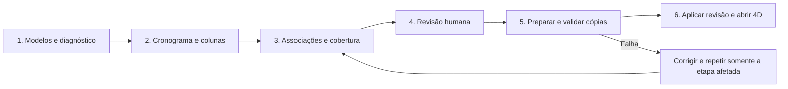

# Preparação federada de IFC e cronograma

Status: proposta original preservada abaixo. Em 05/11/2026, um recorte foi implementado localmente: [guia atual](../IMPORTACAO_CRONOGRAMA.md) e [QA](../QA_PIPELINE_FEDERADO_2026-11-05.md). Os itens deste desenho não são todos funcionalidades concluídas.
Data: 05/11/2026. Autor da demanda: Lucas Bicalho.
Base inspecionada: `88d18bc` + alterações locais. Repositório: `C:/dev/ifc4all-2`.

## Decisão recomendada

Transformar o assistente de um arquivo em uma área de **Preparação 4D** por projeto. Um processamento reúne vários modelos, um cronograma e as decisões de associação. Reutilizar Node, Python/IfcOpenShell e o visualizador existentes; adicionar uma fila local de trabalhos, inventário consultável e área temporária de resultados. Não incorporar outro servidor BIM completo para o piloto.

O IFC define a identidade e a informação física; o cronograma externo define as atividades e suas datas; o projeto Coral registra vínculos, premissas e decisões humanas. Nenhuma dessas fontes pode substituir silenciosamente a outra.

## Constatações no código atual

| Evidência | Consequência |
|---|---|
| `viewer/src/ifc/schedule-import-ui.ts`: um seletor, um `source`, um inventário | Só um modelo participa da análise; trocar o modelo apaga o estado de conferência. |
| `tools/schedule/schedule_ifc.py`: seis famílias em `CLASSES` | Um arquivo de canteiro/instalações pode abrir no viewer e ter poucos ou nenhum elemento reconhecido pelo assistente. Ausência no inventário não comprova ausência no IFC. |
| `viewer/src/ifc/schedule.ts`: lista própria de categorias | Ampliar somente o Python não assegura que o 4D reconhecerá os resultados. |
| `schedule-import.ts`: vínculos somente por GlobalId no inventário selecionado | Um cronograma federado precisa também identificar o modelo. |
| `server/schedule-preparation.mjs`: quantidade de linhas precisa coincidir com o CSV inteiro | Recortes de atividades por modelo não são aceitos pelo contrato atual. Não remover essa checagem sem substituir por uma conferência global de cobertura. |
| `src/production/storage.ts`: JSON portátil limitado a 50 milhões de caracteres; IFCs em base64 | A análise de IFC até 100 MB não garante seu salvamento. O base64 e a serialização também multiplicam o uso de memória. |
| `server/workspace.mjs`: limite genérico de transporte e arquivos enviados como JSON/base64 | Persistência, análise e exportação possuem limites diferentes. |
| `server/schedule-preparation.mjs`: uma chamada Python por operação; IA limitada a contexto de 200 mil caracteres | É necessário controlar tamanho de lotes e progresso; enviar o inventário inteiro não escala. |
| `schedule-import-ui.ts`: leitura CSV via `File.text()`, sem de-para; corpo inteiro inerte durante operações | O usuário recebe erro tarde e não pode acompanhar detalhes. Na captura há sinais de texto mal decodificado; confirmar nos bytes antes de diagnosticar a codificação do arquivo. |
| `main.ts`: aplicação e salvamento de um modelo por vez | Repetir o comando em vários modelos pode deixar metade da migração aplicada. |

O limite atual da análise é **100 MB por arquivo**, não 25 MB. A captura pode pertencer à tela já aberta com código anterior. Não afirmar que a preparação de 100 MB equivale a suporte completo de um projeto desse tamanho.

## Componentes existentes pesquisados

Pesquisa em fontes primárias, consultadas em 05/11/2026. A disponibilidade na documentação não significa integração ou teste local.

| Componente | Uso recomendado | Limite da recomendação |
|---|---|---|
| [IfcOpenShell](https://github.com/IfcOpenShell/IfcOpenShell) | Leitura, unidades, estrutura espacial, propriedades e escrita controlada de cópias. Já instalado localmente em 0.9.0.post1. | Fixar versão e conferir compatibilidade com os IFCs usados na aula. |
| [IfcPatch / ExtractElements](https://docs.ifcopenshell.org/autoapi/ifcpatch/recipes/ExtractElements/index.html) | Recortes semânticos opcionais para inspeção/diagnóstico. | Não dividir o STEP por bytes. Não usar união de recortes como maneira automática de reconstruir o original. |
| [IfcCSV](https://docs.ifcopenshell.org/ifccsv.html) | Referência e possível adaptador para extração/de-para de atributos em tabelas, com GlobalId. | Uma linha de cronograma pode abranger muitos elementos; não é uma composição automática completa de planejamento. |
| [IfcTester](https://docs.ifcopenshell.org/ifctester.html) e [validação IfcOpenShell](https://docs.ifcopenshell.org/autoapi/ifcopenshell/validate/index.html) | Diagnóstico de esquema e, opcionalmente, requisitos IDS explícitos. | Diagnóstico básico não equivale a certificação IFC/IDS, nem valida execução física. |
| [IfcDiff](https://docs.ifcopenshell.org/ifcdiff.html) | Comparar revisões como verificação adicional de geometria/propriedades. | Não substitui os invariantes e a releitura do resultado pelo Coral. |
| [Ifc4D](https://github.com/IfcOpenShell/IfcOpenShell/tree/v0.8.0/src/ifc4d) | Avaliar importadores de formatos de planejamento e modelo nativo de tarefas IFC numa fase seguinte. | Manter o PSet Coral e o leitor atual no primeiro incremento; troca de representação exige compatibilidade. |
| [IfcMCP](https://docs.ifcopenshell.org/ifcmcp.html) | Possível adaptador futuro para consultas por agentes. | Expõe edição e salvamento; não ligar essas capacidades diretamente ao original nem pressupor que o Codex atual as usa. |
| [Speckle IFC, código atual](https://github.com/specklesystems/specklepy/tree/main/src/speckleifc) | Referência de extração e arquitetura; [UX de trabalhos de importação](https://speckle.systems/updates/new-file-importers-and-increased-file-size-limit/). | O [repositório antigo](https://github.com/specklesystems/speckleifc) está arquivado e aponta para specklepy. Adotar a plataforma toda seria uma mudança maior que a necessária ao piloto local. |
| [That Open / web-ifc](https://github.com/ThatOpen/engine_web-ifc) | Manter o visualizador já integrado e a releitura do resultado. | Não atualizar dependências gráficas nesta evolução por conveniência. |

Nenhum código de terceiros foi copiado ou instalado nesta pesquisa. Para incorporar módulos, registrar versão, licença, créditos, dependências e ensaio do adaptador. Avaliar a licença por pacote, não presumir uma licença única para todo um monorepositório.

## Fluxo e experiência

Uma área ampla no lugar do formulário longo. Etapas no topo; resumo e progresso persistentes; tabela central; detalhes à direita. Um botão principal por etapa. Ações inválidas ficam desabilitadas com o requisito escrito e acesso à correção. O erro fica junto à origem e no resumo, preservando o preenchimento.

1. **Modelos.** Selecionar vários arquivos já importados ou adicionar outros. Tabela com nome, revisão/hash curto, tamanho, esquema, unidades, disciplina informada, classes, locais, quantidade de elementos, elegibilidade para o 4D e situação. Mostrar também os elementos ignorados e seu motivo. A análise pode ser repetida somente para os modelos alterados.
2. **Cronograma.** Carregar o CSV independentemente da conclusão da análise IFC. Mostrar prévia e de-para de colunas, codificação UTF-8/Windows-1252, separador e formatos de data explícitos. Suportar ID, nome, início, fim, local, serviço e referência de modelo opcional. Identificar linhas-resumo, marcos e atividades sem representação 3D sem descartá-los.
3. **Associações.** Grade de atividades com modelos, locais, serviço, elementos vinculados, origem da proposta, motivo, pendência e conferência. Selecionar candidatos no inventário filtrado ou no 3D; permitir um vínculo em vários modelos na mesma atividade. Aceitar/rejeitar sugestões individualmente ou por lote com prévia de alcance.
4. **Revisão.** Resumo: atividades vinculadas, sem elemento por decisão, fora do recorte com motivo, não resolvidas e conflitos. Pendências impeditivas bloqueiam aplicação; ausência de 3D justificada não vira data inventada ou elemento fictício.
5. **Preparação.** Cada modelo mostra sua etapa real, tempo, resultado e tentativas. Falha em um modelo preserva os já preparados; não altera o projeto ativo. Cancelar interrompe a preparação e mantém o checkpoint. Percentual apenas quando há total conhecido; leitura IFC sem progresso granular usa indicador indeterminado.
6. **Aplicação.** Exibir diferenças, conferente, destino e nova revisão. Confirmar uma vez para o conjunto aprovado. Só declarar sucesso após validação, gravação e releitura. Oferecer abrir 4D e baixar relatório de rastreabilidade.

### Controle do usuário

Correções manuais ficam marcadas e prevalecem sobre a automação. Alterar um modelo, CSV ou regra invalida apenas os resultados dependentes. O usuário pode retornar à etapa anterior, reabrir a sessão, comparar proposta, remover um vínculo e refazer uma análise. Uma revisão com pacotes existentes permanece bloqueada no piloto até haver análise de impacto própria.

## Tratamento de arquivos e lotes

**Particionar o trabalho, mantendo o IFC original íntegro.** O primeiro processamento extrai o inventário com IfcOpenShell. Os lotes seguintes usam metadados por modelo, edifício/pavimento, classe e serviço; não enviam geometria à IA. A identidade inclui modelo e GlobalId em todos os lotes.

- Processar um modelo pesado por vez inicialmente; liberar sua memória antes do próximo. Medir pico de memória e duração antes de aumentar concorrência.
- Não chamar essa estratégia de parsing IFC em streaming: o parser pode continuar carregando um arquivo inteiro. Paginação do inventário reduz o navegador/LLM, mas não elimina o custo de leitura inicial.
- Trocar o transporte de grandes base64 por bytes em uma área temporária autorizada, com hash. Node controla os caminhos; o cliente recebe IDs opacos.
- IA recebe candidatos limitados por tamanho e contexto, com indicação explícita da cobertura do recorte. Uma busca sem resultado não prova inexistência no modelo inteiro.
- Usar vínculos exatos existentes antes da busca textual. Nomes e locais ajudam a encontrar candidatos, mas não são chaves de identidade.
- Extração física com IfcPatch é uma ferramenta de diagnóstico opcional. Aplicar alterações aprovadas ao modelo original em staging por identidade; nunca fundir pedaços à força.
- Validação incremental preserva resultado, manifesto e diagnóstico por revisão, versão do extrator e perfil. Cache não é fonte canônica e pode ser reconstruído.

## Dados e persistência

Manter JSON para regras/decisões do projeto. Para a próxima versão da pasta, usar um **manifesto leve** que referencia `Modelos/<sha256>.ifc`, já compatível com a organização física existente. Os arquivos IFC deixam de ser repetidos em base64 em cada histórico. Leitor v1 permanece; migração gera revisão nova e backup, sem sobrescrever silenciosamente o pacote antigo. Exportação portátil passa a ser uma operação separada, com limites declarados.

Inventário inicial pode ser JSONL paginado mais índices em memória. SQLite só se o ensaio justificar consultas/concorrência que isso não atende; CSV e Parquet são saídas analíticas, não a fonte transacional de decisões. Não criar simultaneamente dois estados canônicos para pacotes, restrições ou tarefas.

Modelo lógico proposto:

- `SourceModel`: modelId, hash, esquema, unidades, tamanho, arquivo e diagnóstico.
- `Element`: modelId + GlobalId; hash da revisão, classe, locais, propriedades selecionadas e elegibilidade 4D.
- `ScheduleSource`: hash dos bytes originais, codificação, separador e perfil de colunas.
- `Activity`: ID externo estável, nome, datas originais/normalizadas, tipo e situação de cobertura.
- `Binding`: activityId, modelId, GlobalId, origem, regra/modelo de IA, justificativa, conferente e versão.
- `ImportJob`: ID, projeto/revisão esperada, hashes de entrada, etapas, tentativas, resultados, erros e decisões.
- `ChangeSet`: conjunto aprovado, hash de cada IFC de entrada/saída, linhas aplicadas por modelo, exclusões justificadas e resultados de validação.

GlobalId repetido dentro do mesmo modelo bloqueia associação. Repetição entre modelos exige escopo explícito, sem mesclar elementos. Mesmo arquivo/hash não é importado duas vezes como fonte acidental.

## Serviço local e observabilidade

Manter Node como coordenador e Python como worker restrito, evitando framework distribuído. A UI consulta o estado do trabalho por API local versionada. Proposta de contrato, ainda não implementada:

| Operação | Endpoint proposto | Semântica |
|---|---|---|
| Iniciar | `POST /__coral_local/v1/import-jobs` | Cria trabalho com fontes e revisão esperada; devolve 202 e ID. |
| Acompanhar | `GET /__coral_local/v1/import-jobs/{id}` | Etapa, contagens, avisos, erro estruturado e ações disponíveis. |
| Inventário | `GET .../{id}/elements?modelId=...&cursor=...` | Consulta paginada, filtros e total; não devolver tudo em HTML. |
| Corrigir | `PATCH .../{id}/mappings` | Edição validada, com revisão esperada e prévia de invalidações. |
| Preparar | `POST .../{id}/prepare` | Gera resultados em staging; não troca modelos ativos. |
| Cancelar/repetir | `POST .../{id}/cancel` e `/retry` | Idempotentes; tentativas identificadas, sem resultados atrasados aplicados. |
| Aplicar | `POST .../{id}/apply` | Revisão esperada + hash do conjunto aprovado; resposta só após gravação autoritativa. |

Preservar validação de origem local, token e escopo de pasta. GETs de inventário também exigem sessão. Não aceitar caminho arbitrário, comandos shell ou scripts gerados pela IA. Logs não contêm chaves ou payload IFC inteiro. Eventos registram trabalho, modelo, etapa, contagens, duração, tentativa, código de erro e recomendação.

Estados: aguardando → analisando → aguardando revisão → preparando → validando → pronto para aplicar → aplicando → concluído; falhou/cancelado/interrompido são estados explícitos. Reinício do servidor identifica operação interrompida; retomar exige conferir hashes e outputs existentes.

## Integridade na aplicação

1. Congelar o plano aprovado e a revisão esperada do projeto.
2. Gerar cópias por modelo em staging, com apenas as atividades vinculadas àquele modelo.
3. Conferir que toda atividade do CSV tem destino/decisão; comparar as datas e IDs com a origem global. Não exigir que cada modelo contenha o CSV inteiro.
4. Reabrir todos os resultados, conferir identidade, unidades, posicionamentos, representações e propriedades fora do escopo de alteração. Conferir também tarefas no leitor 4D do Coral.
5. Registrar artefatos imutáveis. Só depois trocar o manifesto do projeto por gravação atômica e comparação da revisão esperada. Arquivos preparados sem manifesto ativo não contam como migração aplicada.
6. Se o servidor parar após trocar o manifesto, a retomada reconcilia pelo ID/hash da operação em vez de aplicar duas vezes. Se falhar antes, manter a revisão anterior ativa.
7. Não prometer transação universal de diretório: o ponto de confirmação é um único manifesto, com referências a arquivos já escritos e verificados. Histórico e recuperação precisam distinguir falha anterior/posterior a esse ponto.

## IA e agentes

Definir capacidades, sem delegar autoridade de gravação: **diagnosticar modelo**, **normalizar cronograma**, **propor associações**, **verificar integridade** e **preparar cópias aprovadas**. Diagnóstico, datas, cálculos e verificação são determinísticos. A IA auxilia interpretação de colunas/serviços e vínculos ambíguos.

Codex permanece o executor didático principal; chave de API é um adaptador opcional quando implementado. MCP pode oferecer ferramentas restritas de consulta. O servidor IfcMCP documentado inclui edição e `save` que pode sobrescrever o arquivo; por isso não deve ser exposto inteiro ao agente do aluno. Qualquer integração futura precisa de escopo de arquivos e lista de operações. Não há MCP nem novos harnesses instalados por este plano.

## Sequência de entrega e aceite

1. Contratos e inventário comum: modelo + GUID, diagnóstico de todas as classes, suporte 4D explícito; preservar TORRE02.
2. Jobs locais + staging + persistência leve compatível com v1. Corrigir limite de análise versus gravação antes de anunciar suporte federado de arquivos grandes.
3. Tela por etapas + de-para CSV + inventário paginado + progresso/retomada.
4. Vínculos federados manuais/determinísticos e balanço global de cobertura. Datas permanecem rastreáveis.
5. Preparação validada e aplicação de uma revisão; abertura no 4D e no projeto reaberto.
6. IA por lotes, opt-in, com motivo e conferência; MCP/IDS e formatos adicionais somente após estabilizar o caminho manual.

Aceite obrigatório: dois IFCs com uma atividade compartilhada; GlobalId igual em modelos distintos; CSV Windows-1252 e UTF-8; linhas-resumo e tarefa sem 3D; cronograma parcialmente fora do recorte; classe ignorada pelo leitor; revisão modificada durante análise; falha no segundo modelo; cancelamento e resposta tardia; reinício antes/depois da confirmação; disco indisponível; abertura v1 e migração reversível; arquivo real >25 MB com geometria significativa; memória medida; salvar/reabrir e verificar modelos, cronograma, pacotes, restrições e suprimentos; regressão TORRE02.

Testes automatizados e ensaio no navegador/Windows são critérios diferentes. A pesquisa e o protótipo não aprovam esses cenários. Não houve mudança de runtime, instalação, commit ou publicação nesta rodada de desenho.
