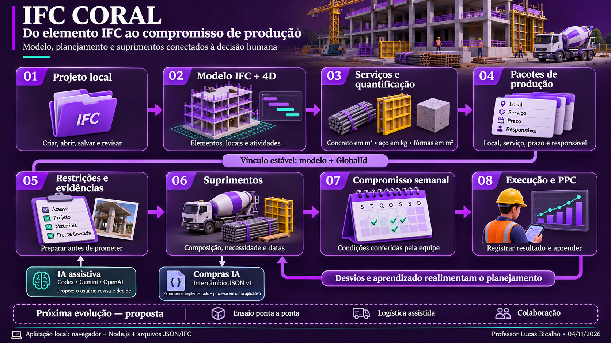
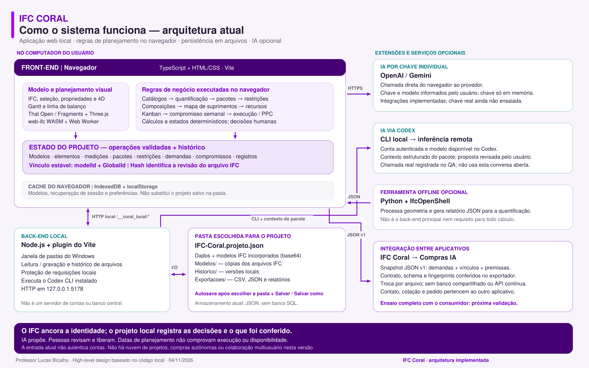
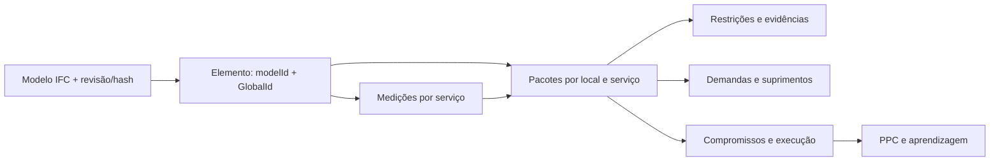

# IFC Coral — visão geral e arquitetura

**Autor:** Professor Lucas Bicalho. **Data:** 04/11/2026. **Escopo:** arquitetura implementada no repositório independente `C:/dev/ifc4all-2`, incluindo o intercâmbio JSON v1 com Compras IA. Referência anterior de código: `b46d0c8`. Este documento acompanha o fechamento da integração e não altera o contrato v1 congelado.

## O que é o projeto

O IFC Coral conecta a representação da obra à preparação do trabalho. A pergunta que organiza o sistema é: **a equipe pode assumir esse serviço, nesse local e nesse prazo, com condições para cumpri-lo?**

O projeto evoluiu do IFC4ALL e da contribuição 4D de Luiz Sales. À visualização do modelo e das atividades, acrescentamos quantificação, pacotes de produção, restrições, suprimentos, compromisso semanal e acompanhamento. A IA apoia a análise; a decisão e a comprovação continuam com as pessoas.

Hoje, trata-se de uma **aplicação web local para uso didático e experimentação**. O navegador apresenta o modelo e executa a maior parte das regras de planejamento. Um serviço Node.js no computador permite acessar as pastas escolhidas e executar o Codex instalado. Os projetos ficam em arquivos locais.



*Ilustração conceitual produzida com IA e revisada contra o código; não é uma captura da interface. A faixa “Próxima evolução” indica propostas, não funcionalidades entregues.*

## O fluxo de trabalho

| Etapa | O que a pessoa faz | Informação produzida ou utilizada |
|---|---|---|
| 1. Projeto local | Cria ou abre uma pasta; pode começar com a TORRE02 ou importar outro IFC. | Projeto independente, modelo e histórico de gravação. A entrada atual não autentica contas. |
| 2. Modelo e 4D | Seleciona elementos, pavimentos e atividades; consulta propriedades e sequência. | Identidade física, localização, quantitativos existentes e datas da origem. Gantt, linha de balanço e filtros oferecem diferentes leituras. |
| 3. Serviços e quantificação | Escolhe concretagem, armação, fôrmas ou serviço cadastrado; ajusta regras e confere a medição. | Quantidade por serviço e unidade, memória e pendências. Uma mesma seleção pode originar serviços diferentes. |
| 4. Pacotes de produção | Organiza o recorte por local, serviço, elementos, responsável e janela. | Pacote vinculado aos elementos. Lista e Kanban apresentam sua preparação e situação. |
| 5. Restrições e evidências | Analisa condições, atribui responsáveis e prazos, registra comprovação e liberação. | Condições por categoria e alcance. IA propõe texto; a equipe revisa e confirma. Prints podem compor a evidência local. |
| 6. Suprimentos | Confere composição, necessidades, cobertura e prazos; registra recursos, reservas e recebimentos. | Mapa macro e detalhado, datas regressivas, lacunas e exportações. O detalhamento evita repetir a parcela macro correspondente. |
| 7. Compromisso semanal | Confere preparação e assume um compromisso verificável. | Quantidade, prazo e critério congelados. Mover um cartão no Kanban exige os requisitos da etapa. |
| 8. Execução e aprendizagem | Registra início, conclusão, evidência e motivos de desvio. | Resultado, PPC e aprendizado. A data do calendário não comprova execução. |

As etapas representam um ciclo. O mapa de suprimentos pode nascer da previsão 4D antes da criação de todos os pacotes. Novos recortes e revisões refinam a previsão, mantendo sua origem.

## Front-end, back-end e armazenamento



[Abrir o diagrama técnico vetorial](02-arquitetura-tecnica.svg).

| Parte | Tecnologia e responsabilidade | Onde está no código |
|---|---|---|
| Front-end | TypeScript, HTML e CSS com DOM nativo. Vite serve a aplicação e gera o build. Não há React nesta base. | `viewer/src/main.ts`, `viewer/src/ui/`, `viewer/src/workspace/portal.ts` |
| Visualizador | That Open Components/Fragments e Three.js; leitura IFC por web-ifc/WASM, com worker e assets locais. | `viewer/src/ifc/`, `viewer/public/engine/` |
| Regras do negócio | Pacotes, restrições, catálogos, composições, mapa, reservas, compromisso, PPC, operações e histórico executados no navegador. | `viewer/src/production/`, `viewer/src/quantification/` |
| Back-end local | Plugin Node.js do Vite para pastas, arquivos e Codex. Requisições locais usam proteção por origem e token de sessão. Não é autenticação de usuários. | `viewer/server/workspace.mjs`, `viewer/vite.config.ts`, `viewer/src/workspace/bridge.ts` |
| Persistência | JSON e IFC na pasta escolhida, com gravação, histórico e recuperação. IndexedDB/localStorage são apoio de cache e sessão. | `viewer/src/workspace/local.ts`, `viewer/src/production/storage.ts` |
| IA | Codex CLI acionado pelo serviço local; OpenAI/Gemini por chamada direta do navegador com chave individual em memória. | `viewer/server/codex-analysis.mjs`, `viewer/src/production/ai.ts`, `viewer/src/production/constraint-analysis.ts` |
| Quantificação offline | Python/IfcOpenShell processa geometria e produz relatório importável, associado à revisão do IFC. | `tools/quantification/` |
| Intercâmbio Compras IA | Exportador de snapshot JSON, schema, contexto de origem e fingerprints. É uma troca por arquivo entre aplicativos. | `viewer/src/production/procurement-export.ts`, `docs/contracts/` |

**O navegador é mais que a tela.** Ele também calcula quantidades e necessidades, valida mudanças e deriva as situações apresentadas pelas vistas. O Node.js é uma ponte para capacidades locais que a página não pode executar livremente.

**O Codex tem dois papéis distintos.** Pode ajudar a instalar, desenvolver e operar a aplicação. Dentro do produto, a opção de IA aciona uma execução específica do CLI, com contexto estruturado do pacote e saída validada. Ela não consulta automaticamente esta conversa. O processo é local, mas a inferência utiliza o serviço remoto do provedor e depende de acesso, rede e disponibilidade do modelo.

**O build estático não contém sozinho todas as capacidades locais.** A ponte de pastas e a chamada ao Codex dependem do processo Node.js configurado no Vite. Há alternativas de acesso a arquivos pela API do navegador quando disponíveis; elas não substituem o serviço de execução do Codex.

## O elemento como vínculo da informação

A identidade persistente de uma ocorrência é **`modelId + GlobalId`**. Nome, posição na árvore ou identificador temporário de renderização não substituem essa chave. O hash permite conferir a revisão do arquivo IFC.

O IFC ancora os elementos, suas propriedades de origem e a geometria. As decisões operacionais — por exemplo, quem liberou uma restrição ou qual compromisso foi assumido — ficam no estado do projeto, relacionadas a esses elementos. O sistema não transforma uma proposta de IA em fato nem grava automaticamente essas decisões no IFC original.

Um elemento pode participar de um pacote de fôrmas, outro de armação e outro de concretagem. Cada serviço mantém unidade, método, memória e conclusão próprios. Concluir a concretagem não comprova a conclusão de todos os serviços de um elemento.



Gantt, Kanban, gestão visual, checklist e mapa consultam os vínculos do mesmo projeto. Seleção e cores são representações de trabalho; não são uma base independente de aprovação. Revisar o IFC ou alterar uma regra pode exigir nova conferência da medição ou dos vínculos.

## Onde os dados são salvos

A pasta do projeto é separada da instalação do software:

```text
Pasta escolhida pelo usuário/
├── IFC-Coral.projeto.json    dados do projeto + modelos IFC incorporados
├── Modelos/                 cópias IFC auxiliares, identificadas por hash
├── Historico/               versões locais gravadas
└── Exportacoes/             saídas produzidas pela aplicação
```

O arquivo principal usa um envelope portátil com `project` e os bytes dos modelos codificados em base64. A cópia solta em `Modelos/` não é, isoladamente, o projeto completo. O formato atual limita o arquivo portátil a 50 MB; modelos grandes e muitos anexos precisam ser considerados na evolução do armazenamento.

Após escolher a pasta, o autosave agenda a gravação dois segundos depois das mudanças válidas. Permanecem Salvar, Salvar como, histórico e até 50 operações de desfazer/refazer na sessão. O sistema confere conflitos antes de sobrescrever e mantém os registros congelados consultáveis. O registro local de pastas aponta para destinos escolhidos; não é um banco de projetos na nuvem.

## IA, quantificação e suprimentos

O usuário pode editar propostas antes de adotá-las. Categorias vazias de restrições recebem sugestões sem serem contadas como novas condições já identificadas; condições humanas ou liberadas são preservadas. Cálculos, datas, consolidação, cobertura e PPC continuam regidos por regras explícitas.

Volume declarado, taxa de aço e área de fôrmas são informações diferentes. Aço por taxa é estimativa, não dimensionamento estrutural. A geometria de contato das fôrmas pode exigir processamento e revisão específicos. Quantidade desconhecida permanece pendente, não vira zero.

O mapa combina previsões 4D e demandas dos pacotes, com composição, perdas e prazos editáveis. Diferencia consumo, reutilização e concreto fresco. A exportação para Compras IA preserva origem, unidades, lacunas e o contexto pertinente. O arquivo não contém bytes IFC, imagens das evidências ou chaves de IA; referências às evidências não são os próprios anexos.

**O que já foi validado:** geração, download, schema e fingerprints do exportador, incluindo um recorte real da TORRE02. **O que ainda exige ensaio:** o fluxo completo no aplicativo consumidor até refinamento e comparativo. Não existe sincronização contínua de volta ao Coral nesta integração.

## Próximos passos recomendados

1. **Fechar o ciclo entre os aplicativos.** Validar o mesmo recorte no Compras IA, preservar sua origem durante o refinamento e conferir a saída do comparativo. Qualquer retorno de dados ao Coral precisa de contrato próprio e revisão antes da adoção.
2. **Consolidar a experiência de aula.** Ensaiar instalação limpa, salvar/reabrir, permissões, recuperação e operação completa em outra máquina. Produzir o roteiro com capturas da versão efetivamente ensaiada.
3. **Evoluir a logística com dados reais.** Comparar necessidade em obra, prazo prometido e recebimento; testar cenários de antecipação e capacidade. Previsões assistidas precisam de histórico e revisão humana antes de orientar decisões.
4. **Escalar conforme a necessidade comprovada.** Avaliar carregamento do 3D e tamanho do projeto; depois decidir se colaboração, autenticação e banco central são necessários. Esses recursos não estão implementados nem são requisito para concluir o laboratório local.

## Evidências e limites

- Revalidação em 04/11/2026: **201 testes aprovados**, `npm run typecheck` e `npm run build` aprovados. Permanece o aviso de bundle grande; isso merece otimização antes de ampliar a distribuição.
- Ensaio visual do exportador em 02/11/2026: [recibo técnico e arquivos de evidência](../QA_INTEGRACAO_COMPRAS_2026-11-02.md). A sessão corrente do professor não foi alterada nesta documentação.
- Codex: chamadas reais documentadas no [QA de restrições](../QA_IA_RESTRICOES.md). OpenAI e Gemini: transporte controlado, sem ensaio com chave real nesta base.
- Estado funcional completo e limites de aceite: [ACEITE](../ACEITE.md), [PROGRESSO](../PROGRESSO.md). Origem e dependências: [créditos](../CREDITOS.md).

Os testes demonstram o comportamento nos cenários exercitados; não constituem validação institucional, técnica estrutural ou de uso em produção. O kit acadêmico aprovado e os documentos institucionais ficam preservados.

## Fontes dos desenhos

- `01-fluxo-funcional.png`: imagem conceitual gerada com IA a partir do fluxo conferido no código.
- `02-arquitetura-tecnica.svg` e `.png`: diagrama técnico com conteúdo explícito, fonte vetorial e renderização revisada.
- `render_architecture.py`: fonte reproduzível do diagrama técnico. Execute com Python e PyMuPDF; a imagem funcional original é independente do renderizador.

Os caminhos de código na tabela de arquitetura são relativos à raiz do repositório. Os links de evidências acima são relativos a `docs/architecture/`, destino canônico deste documento.
