# IFC Coral — guia de operação

Professor Lucas Bicalho

Interface v02. Cenário didático de concretagem. Os números sobre as telas correspondem às instruções ao lado no PowerPoint e no PDF.

Abra http://127.0.0.1:5178/ para operar a sua cópia. Os prints foram obtidos em uma origem local separada para preservar o projeto do professor.

## 1. Acesso ao laboratório

1. Abra http://127.0.0.1:5178/ no navegador.
2. Se não abrir, peça ao Codex para executar iniciar.ps1 em C:/dev/ifc4all-2.
3. Comece com um projeto vazio. Veja a preparação no próximo slide.

**Resultado esperado:** A tela mostra IFC Coral e o botão Abrir TORRE02.

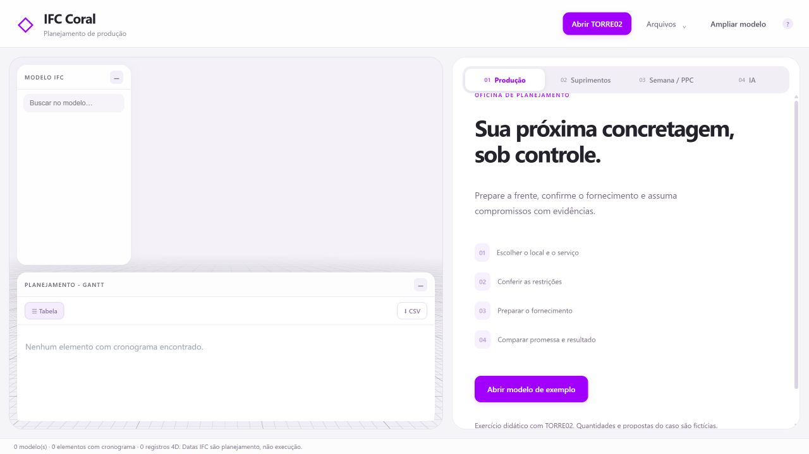

## 2. Preparação de um novo ensaio

1. Se já houver um trabalho seu, use Arquivos > Exportar projeto e guarde o JSON.
2. No menu Arquivos, selecione Novo projeto.
3. Confirme Exportei; começar novo. O próximo passo será abrir a TORRE02.

**Resultado esperado:** Um projeto vazio para o teste. O arquivo exportado continua disponível para reabrir seu trabalho.

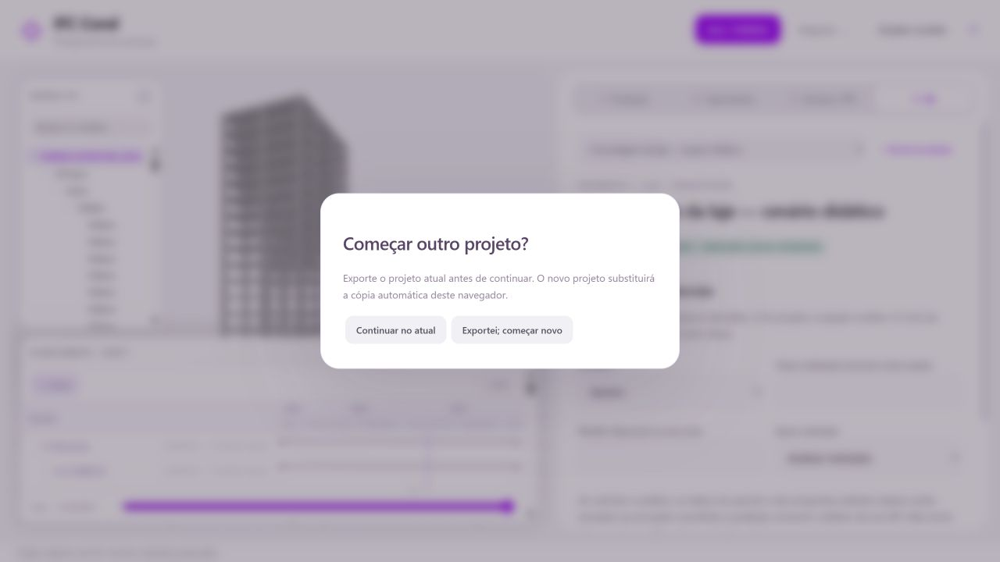

## 3. O modelo e o fluxo de trabalho

1. Clique em Abrir TORRE02 e espere o carregamento.
2. A árvore e o Gantt à esquerda mostram o modelo e seu planejamento.
3. As etapas da oficina ficam na navegação à direita.

**Resultado esperado:** A barra inferior informa 1 modelo e 4.152 registros 4D.

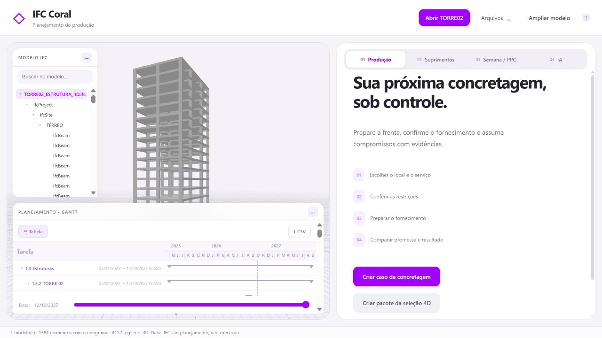

## 4. Criação do caso didático

1. Clique em Criar caso de concretagem.
2. O caso conecta elementos da laje e acrescenta dados para o exercício.

**Resultado esperado:** Você verá o pacote e seus campos de produção.

## 5. Ajuda ao lado de cada campo

1. Clique no botão ? para manter a explicação aberta.
2. Leia a explicação. A ajuda também abre com Tab e Enter.
3. Use Escape para fechar.

**Resultado esperado:** A explicação abre sem preencher ou alterar os dados.

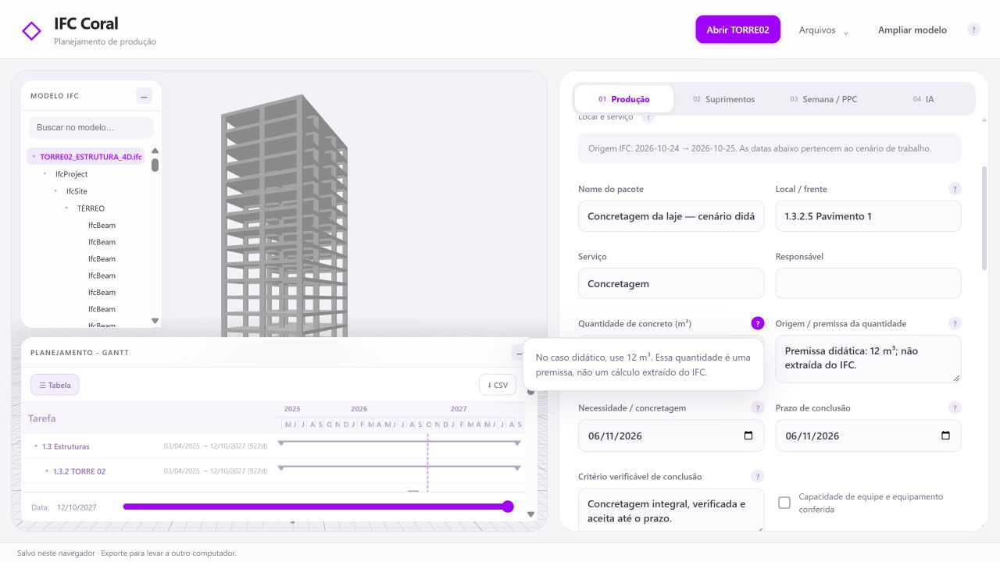

## 6. Definição do pacote

1. Confira o local e o serviço que vieram do modelo.
2. Preencha Responsável com Equipe A.
3. Mantenha 12 m³ e a origem como premissa didática.

**Resultado esperado:** O grupo identifica quem promete e de onde vem a quantidade.

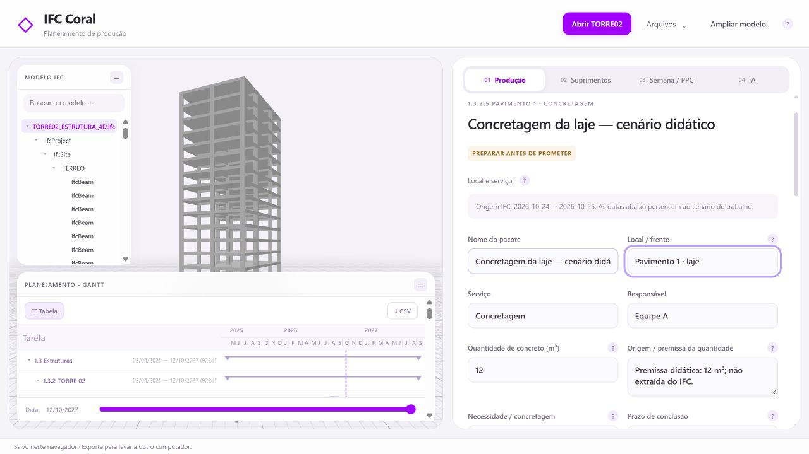

## 7. Datas e critério de conclusão

1. Use 06/11/2026 como necessidade e prazo neste cenário.
2. Confira o critério de conclusão. Marque a capacidade após conferência.
3. Clique em Salvar definição do pacote.

**Resultado esperado:** As datas do exercício ficam separadas das datas originais do IFC.

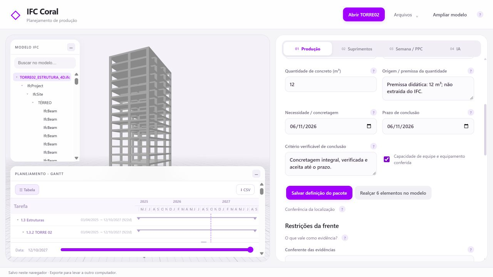

## 8. Remoção de uma restrição

1. Role até Restrições da frente.
2. Informe Professor como conferente.
3. Escreva a evidência fictícia de liberação técnica e clique em Conferir e remover nesse bloco.

**Resultado esperado:** A restrição muda de Pendente para Removida com evidência.

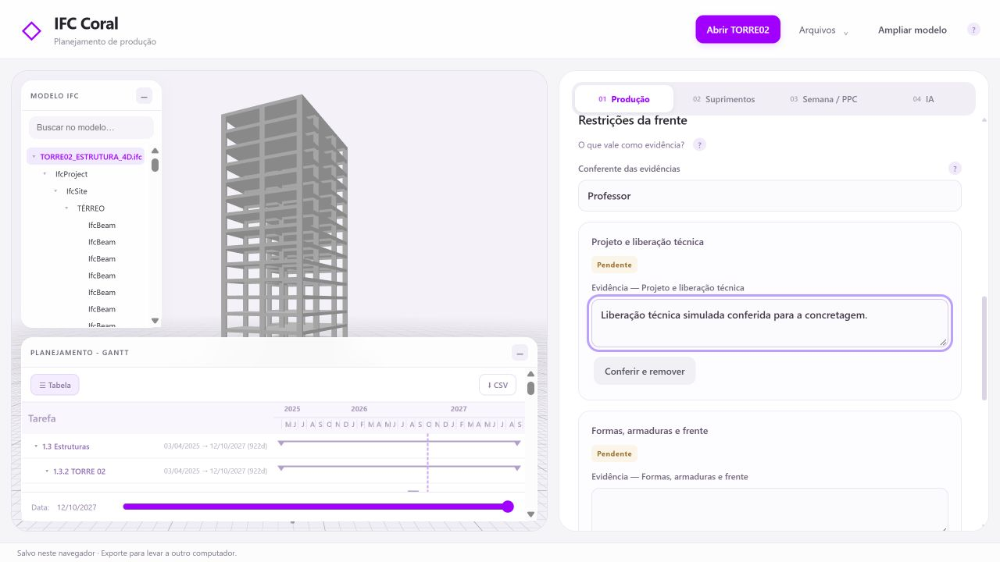

## 9. Condições verificadas e pendências

1. Repita a conferência para formas, armaduras, frente, equipe e equipamento.
2. Use evidências fictícias identificadas como exercício.
3. Mantenha o concreto pendente até confirmar o fornecimento.

**Resultado esperado:** A frente continua bloqueada enquanto houver restrição ou fornecimento pendente.

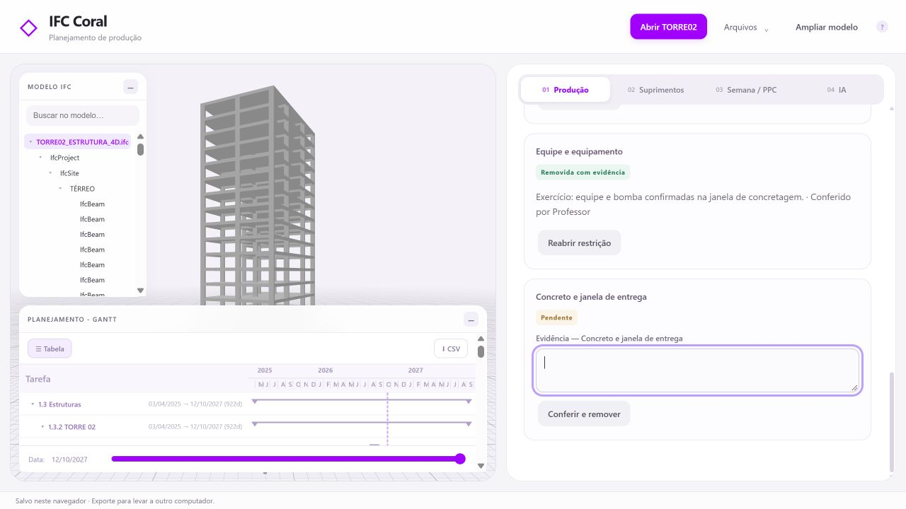

## 10. Conferência da cobertura existente

1. Clique em Suprimentos na navegação superior.
2. Confira a situação e marque Conferi estoque e pedidos existentes.
3. Leia a demanda, a cobertura e o saldo. Concreto fresco não tem estoque antecipado.

**Resultado esperado:** O saldo deixa de A conferir e passa a mostrar o que falta cobrir.

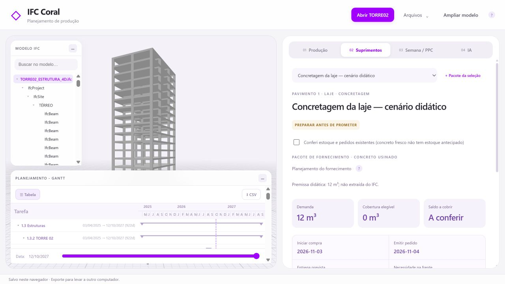

## 11. Comparação de fornecedores

1. Compare as três propostas e seus prazos.
2. A entrega de A está fora da janela. C ainda tem lacuna técnica.
3. Clique no resumo de Fornecedor B para abrir os detalhes.

**Resultado esperado:** As três propostas estão identificadas como simulação.

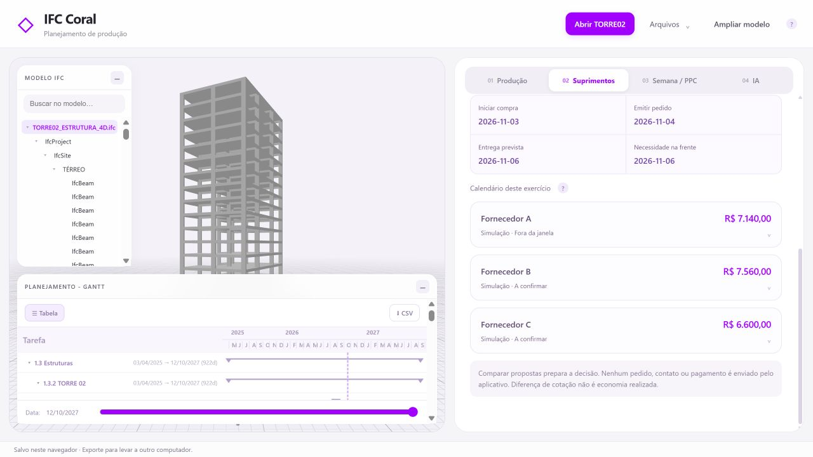

## 12. Confirmação da janela de entrega

1. Confira a quantidade e a entrega prometida.
2. Marque a confirmação somente com evidência.
3. Registre a evidência didática e clique em Salvar proposta / confirmação.

**Resultado esperado:** A proposta fica confirmada. A quantidade ainda precisa ser reservada.

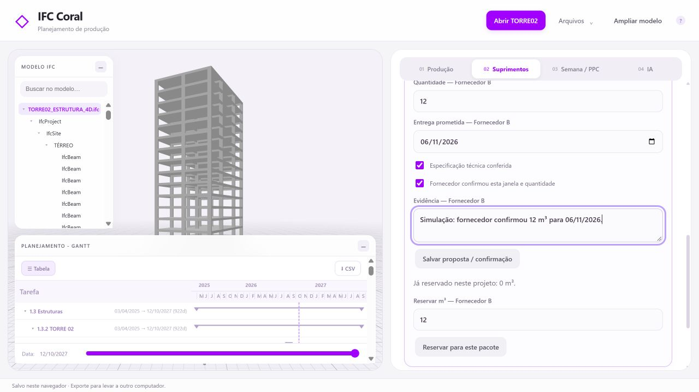

## 13. Reserva para o pacote

1. No mesmo fornecedor, confira 12 no campo Reservar m³.
2. Clique em Reservar para este pacote.
3. A reserva vincula esta quantidade à concretagem.

**Resultado esperado:** A cobertura elegível será 12 m³ e o saldo a cobrir será zero.

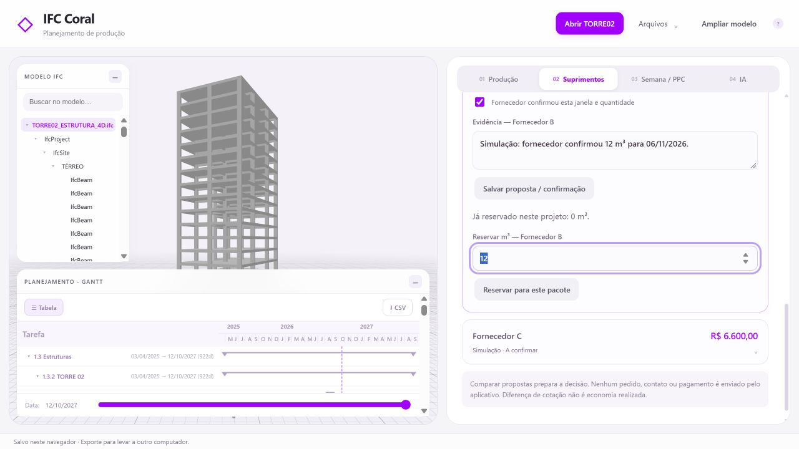

## 14. Fechamento da restrição de material

1. Clique em Produção na navegação superior.
2. Repita o passo 8 para Concreto e janela de entrega. Cite a confirmação de B e a reserva.
3. Informe o conferente e clique em Conferir e remover no bloco do concreto.

**Resultado esperado:** As quatro restrições têm evidência e o pacote pode passar à reunião semanal.

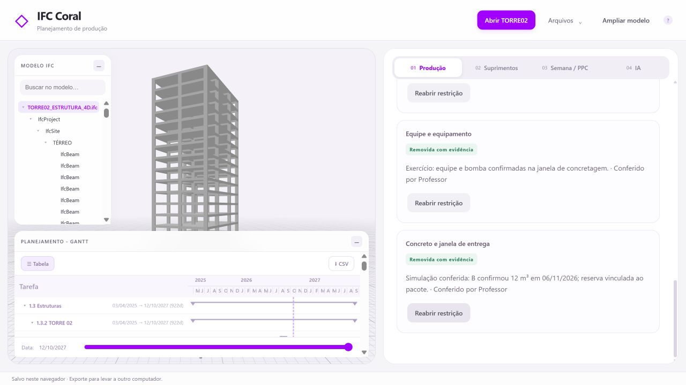

## 15. Preparação do plano semanal

1. Clique em Semana / PPC e confira Pronto para compromisso.
2. Mantenha selecionado o pacote que será assumido.
3. Preencha o responsável com Professor e clique em Assumir compromissos e congelar semana.

**Resultado esperado:** O PPC ainda é Não aplicável, pois a semana não foi congelada.

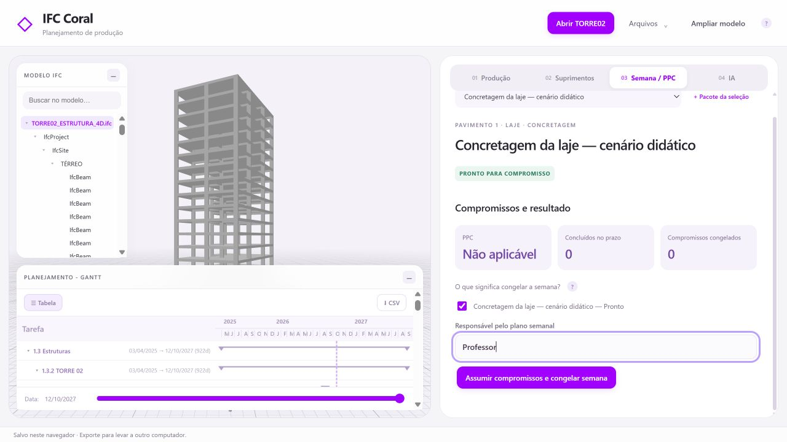

## 16. Compromisso registrado

1. Confira o nome, o prazo, a quantidade e o critério congelados.
2. O compromisso entra no denominador do PPC.
3. Registre a execução somente quando houver evidência.

**Resultado esperado:** Existe 1 compromisso. Antes do apontamento, o PPC é 0%.

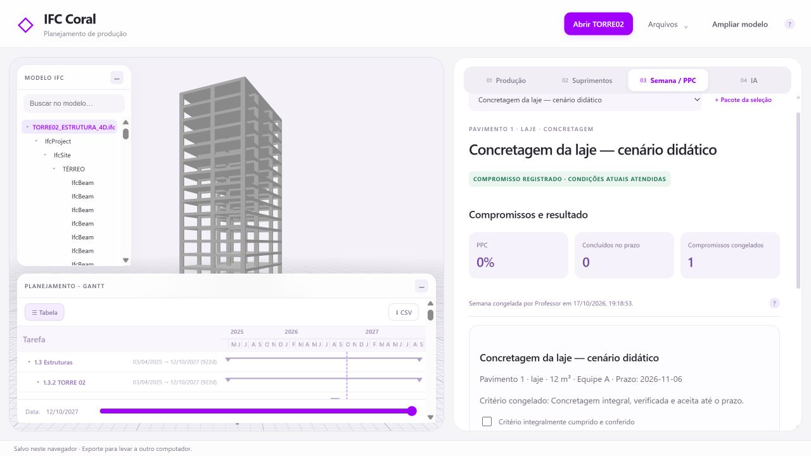

## 17. Recebimento e liberação

1. Volte a Suprimentos e role até Recebimento e liberação desta reserva.
2. Informe 06/11/2026, recebidos 12 e rejeitados 0.
3. Registre o romaneio didático e Professor como conferente. Clique em Registrar recebimento e liberação.

**Resultado esperado:** O registro separa a promessa do fornecedor da entrega efetiva.

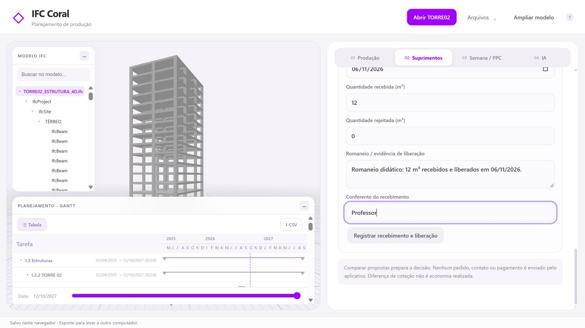

## 18. Apontamento da execução

1. Volte a Semana / PPC. Marque o critério somente se ele foi cumprido por inteiro.
2. Use 06/11/2026 e descreva a conclusão simulada no campo de evidência.
3. Clique em Registrar realizado.

**Resultado esperado:** O PPC considera o prazo e o critério que foram congelados.

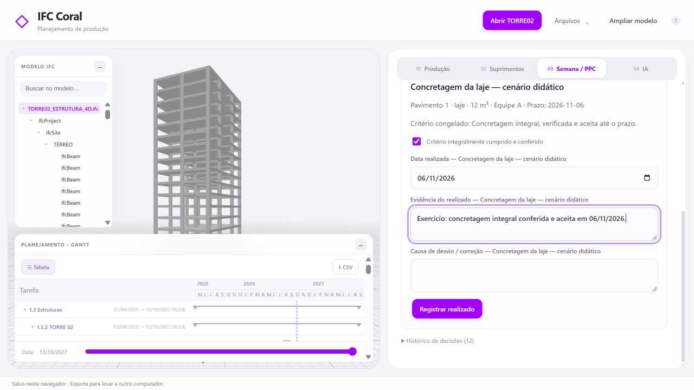

## 19. Leitura do PPC

1. Confira o painel de indicadores.
2. Neste exercício, 1 compromisso de 1 foi concluído no prazo.
3. Use o histórico para revisar as decisões e os desvios.

**Resultado esperado:** PPC de 100% no cenário didático concluído no prazo.

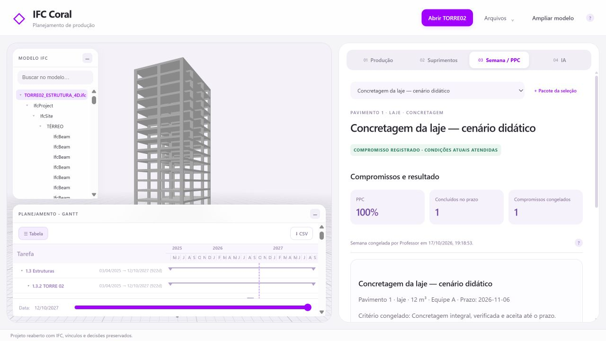

## 20. Arquivo portátil do projeto

1. Abra o menu Arquivos.
2. Clique em Exportar projeto.
3. O arquivo inclui o IFC e as decisões do exercício.

**Resultado esperado:** O navegador baixa IFC-Coral-projeto.json, sem chave de IA.

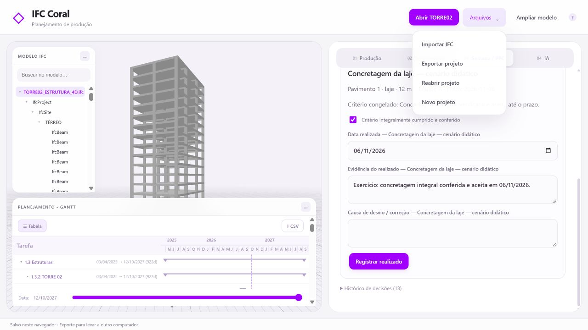

## 21. Conservação do trabalho

1. Guarde o JSON baixado numa pasta fácil de encontrar.
2. O salvamento automático não substitui esse arquivo.
3. Você poderá reabrir o projeto em outra sessão.

**Resultado esperado:** A mensagem inferior confirma a exportação do projeto.

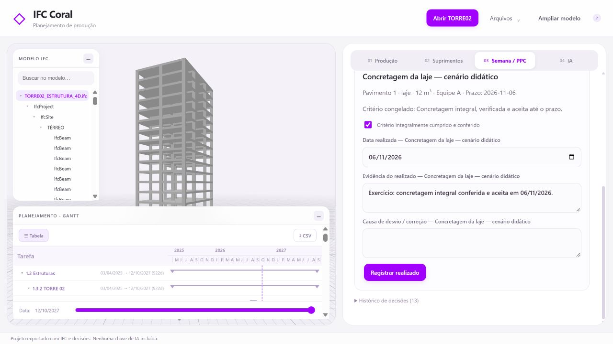

## 22. Reabertura do projeto

1. No menu Arquivos, clique em Reabrir projeto.
2. Selecione o JSON que você exportou.
3. Espere a conferência do IFC e o carregamento.

**Resultado esperado:** Pacote, evidências, compromisso e resultado reaparecem.

## 23. Apoio opcional da IA

1. Clique em IA. Escolha Gemini ou OpenAI.
2. Informe sua chave. Consulte os modelos e preencha um modelo disponível na sua conta.
3. Escolha o apoio e abra Ver os dados. Após conferir, solicite a análise e revise a resposta.

**Resultado esperado:** Opcional, com possível custo de API. Chamadas reais ainda não foram validadas. O fluxo anterior funciona sem IA.

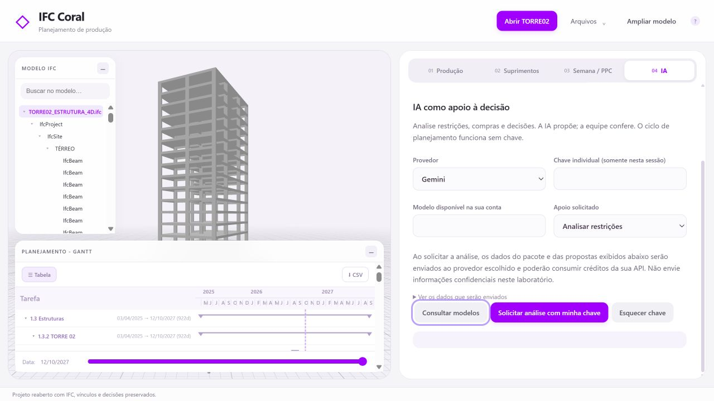

## Exemplo pronto para conferir

O arquivo Exemplo-concluido.IFC-Coral.json inclui IFC, pacote, evidências fictícias, reserva, recebimento e 1 compromisso cumprido no prazo. Reabra pelo menu Arquivos. Para fazer o exercício do zero, use Novo projeto depois de exportar seu trabalho.
